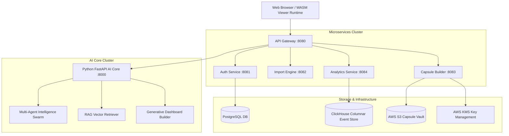

# System Architecture — Dashboard Capsule AI Version 2.0

## 1. High-Level Enterprise System Topology



---

## 2. Security Architecture

- **Authentication**: BCrypt ($cost=12$) password hashing with RS256 RSA JWT issuance & token rotation.
- **Capsule Encryption**: AES-256-GCM KMS Envelope Encryption.
- **Digital Signatures**: ECDSA P-384 hardware-backed cryptographic signing.
- **Canvas Security**: Dynamic SVG watermark overlay + read-only canvas interaction locks.

---

## 3. WebAssembly Client Execution Pipeline

```
.dcaps Package ──► Signature Verification ──► AES-256 Decryption ──► WASM Canvas Memory ──► Interactivity Engine
```
