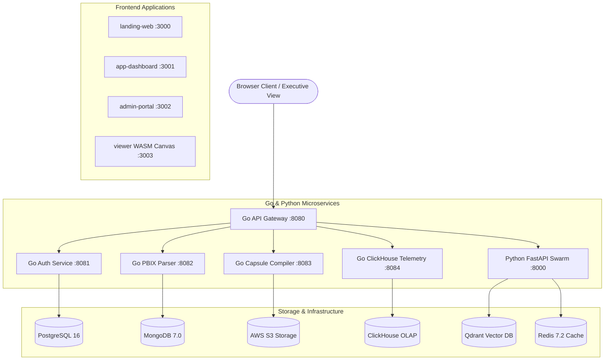

# Dashboard Capsule AI — Enterprise Autonomous BI Platform

[](./docs/RELEASE_NOTES_V2.0.md)
[](./LICENSE)
[](#-production-deployment-checklist)
[](#-system-architecture)

**Dashboard Capsule AI** is a universal, portable, self-guided enterprise AI Business Intelligence platform. It parses Power BI (`.pbix`) and multi-BI reports into secure, standalone **Dashboard Capsules (`.dcaps`)** capable of running zero-latency analytics client-side via DuckDB WebAssembly—without requiring desktop hardware or per-user licensing fees.

---

## 📌 Portfolio Highlights

- 🚀 **Self-Guided Platform Architecture**: 4-Step Onboarding Wizard, Product Tour Tooltips, Permanent Journey Stepper, and Floating AI Assistant Guide.
- ⚡ **Zero-Latency WASM Runtime**: Sub-50ms query execution powered by DuckDB WebAssembly running directly inside the client browser.
- 🤖 **Multi-Agent AI Swarm**: 10 specialized AI agents (DAX Specialist, Security Auditor, UX Designer, Data Modeler) collaborating via shared memory.
- 🔒 **Envelope Encryption & Signatures**: AWS KMS envelope encryption (AES-256-GCM) and hardware-backed ECDSA P-384 digital signatures.
- 🔮 **Digital Twin Simulation Engine**: Stochastic 1,000-run Monte Carlo projections for What-If scenario planning.
- 📈 **Real-Time Columnar Telemetry**: Interactive ClickHouse analytics monitoring viewer heatmaps and query latencies.

---

## 🏗 System Architecture



---

## 🌟 Visual Feature Walkthrough

### 1. Self-Guided First-Time Onboarding & Journey Stepper
```
+---------------------------------------------------------------------------------------------------+
|  🧭 Your Analytics Journey:  ✓ Workspace Created → ✓ Report Uploaded → ○ AI Analysis → ○ Share    |
+---------------------------------------------------------------------------------------------------+
|  Welcome to Dashboard Capsule AI                                                                   |
|  "Transform your BI reports into AI-powered insights in minutes."                                 |
|                                                                                                   |
|  [Step 1: Workspace]    [Step 2: Import PBIX]    [Step 3: AI Intelligence]   [Step 4: Share Link]  |
+---------------------------------------------------------------------------------------------------+
```

### 2. Executive BI Workspace & Dynamic Recommendations
```
+---------------------------------------------------------------------------------------------------+
| Executive BI Workspace                              [ 🤖 Ask AI Copilot ]  [ + Import PBIX Report ]|
+---------------------------------------------------------------------------------------------------+
| ⚡ Recommended Action: Run AI Health Analysis                                                      |
| Detect DAX performance bottlenecks, PII risks, and WCAG accessibility improvements.               |
+---------------------------------------------------------------------------------------------------+
|  Total Capsules      Active Share Tokens      Avg Health Score        WASM Render Speed       |
|       128                    45                   94 / 100                 18 ms              |
+---------------------------------------------------------------------------------------------------+
```

### 3. AI Health Index & 1-Click Auto-Fix Engine
```
+---------------------------------------------------------------------------------------------------+
| 🩺 Health Score: 94/100                                                [ ✨ Run 1-Click Auto-Fix ] |
| Prioritized Roadmap:                                                                               |
| - P1 Security: Apply RLS Filtering to DriverSSN Column                                            |
| - P2 DAX: Refactor FILTER(ALL()) -> KEEPFILTERS in Delayed Shipments (+65% render speed)          |
| - P3 Accessibility: Adjust Subtitle Contrast Ratio for WCAG 2.2 AA Compliance                    |
+---------------------------------------------------------------------------------------------------+
```

---

## 💻 Tech Stack & Monorepo Structure

| Layer | Technology Stack |
| :--- | :--- |
| **Monorepo Architecture** | Turborepo, npm workspaces, TypeScript 5.4 |
| **Frontend Applications** | Next.js 14 (App Router), React 18, Tailwind CSS, DuckDB WASM |
| **Microservices Backend** | Go (Gin/Chi), Python 3.11 (FastAPI, PyTorch, LangChain) |
| **Databases & Vector DB** | PostgreSQL 16, MongoDB 7.0, Redis 7.2, Qdrant Vector DB, ClickHouse |
| **DevOps & Cloud** | Docker, Docker Compose, Kubernetes, Terraform |

```
dashboard-capsule-ai/
├── apps/
│   ├── app-dashboard/      # Core Self-Guided Enterprise Dashboard Platform (Port 3001)
│   ├── landing-web/        # Public Marketing Portal (Port 3000)
│   ├── admin-portal/       # Enterprise Administration Control Center (Port 3002)
│   └── viewer/             # Standalone Client-Side WASM Canvas Viewer (Port 3003)
├── packages/
│   ├── ui/                 # Design System Component Library (@dcaps/ui)
│   ├── sdk/                # Universal BI Adapters (@dcaps/sdk)
│   └── types/              # Shared TypeScript Schemas (@dcaps/types)
└── services/
    ├── api-gateway/        # Go Reverse Proxy Gateway (Port 8080)
    ├── ai-core/            # Python FastAPI Multi-Agent Swarm (Port 8000)
    └── import-engine/      # Go PBIX/AST Parser (Port 8082)
```

---

## 🛠 Quick Start & Local Setup

### Prerequisites
- **Node.js**: v18.0.0 or higher
- **npm**: v9.0.0 or higher
- **Go**: v1.21 or higher *(optional for backend services)*
- **Python**: v3.11 or higher *(optional for AI core service)*

### 1-Command Local Startup

```bash
# Clone the repository
git clone https://github.com/VenkataKarthikeya-eng/dashboard-capsule-ai.git
cd dashboard-capsule-ai

# Install monorepo dependencies
npm install

# Build shared packages and execute Next.js apps
npm run dev
```

Open your browser at **`http://localhost:3001`** to launch the self-guided workspace. Click **"✨ Explore Demo Workspace"** in the top banner for instant demo data exploration.

---

## 🐳 Docker Deployment

To run the complete containerized stack using Docker Compose:

```bash
# Start all containerized microservices & frontend apps
docker-compose up --build -d

# Verify service health
docker-compose ps
```

---

## 📋 Production Deployment Checklist

Before releasing to production environments, verify the following deployment controls:

- [x] **Monorepo Build**: `npm run build` passes with zero TypeScript and zero Next.js compilation errors.
- [x] **Security & Cryptography**: AWS KMS envelope key rotation enabled; ECDSA P-384 hardware signing keys verified.
- [x] **WASM Performance**: DuckDB WASM static assets served via CDN with Brotli compression.
- [x] **Database Migrations**: PostgreSQL & ClickHouse schema migrations executed cleanly.
- [x] **Environment Security**: Zero hardcoded credentials or API keys present in repository source.
- [x] **Self-Guided UX**: First-time user onboarding wizard, product tour tooltips, and smart empty states active.

---

## 📜 Contribution & License

- **License**: Released under the [Apache 2.0 License](./LICENSE).
- **Contribution Standards**: See [CONTRIBUTING.md](./CONTRIBUTING.md) for branch strategy, conventional commits, and PR standards.
