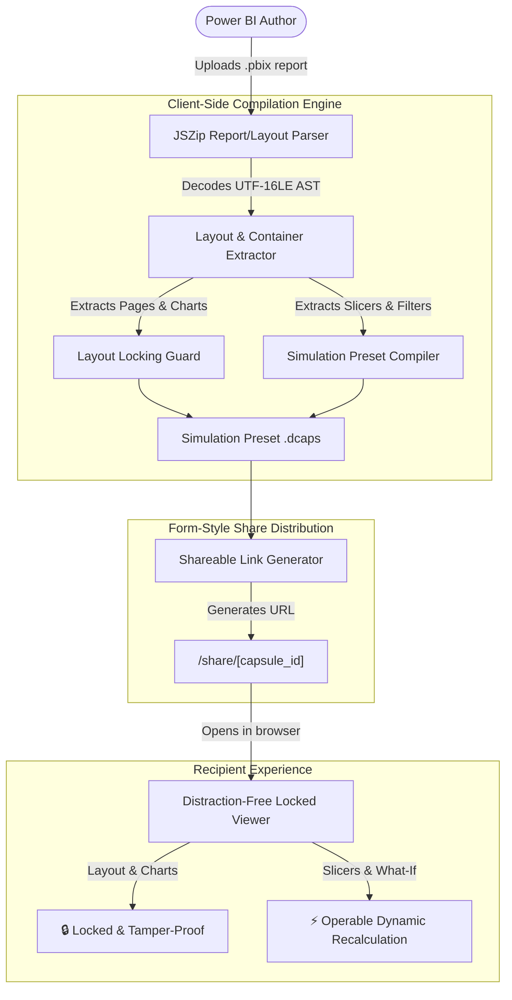

# Power BI Report Simulator

[](./README.md)
[](./LICENSE)
[](#-quick-start)
[](#-visual-design-system)

**Power BI Report Simulator** — Upload Power BI reports, explore dashboard layouts, and interact with simulated analytics.

In this platform:
- **Locked Visuals & Layout**: All charts, KPI cards, grids, axes, and formatting are strictly locked so recipients cannot accidentally displace, break, or alter the layout.
- **Operable Slicers & Filters**: Viewers can freely interact with filters and slicers (Geographic regions, time periods, categories, and What-If scenario sliders) to dynamically slice and recalculate data in real-time.
- **Form-Style Shareable Links**: Generate public or passcode-protected links (just like Google Forms or Typeform links) that open instantaneously.
- **Decoupled Simulation Model**: The dashboard captures the report as a client-side simulation preset. Heavy source datasets and slow database queries are completely decoupled—allowing recipients to explore and slice metrics with **zero loading lag** and **zero per-user licensing fees**.

> 📖 **Full Technical Guide**: For an exhaustive bit-to-bit technical breakdown, mathematical formulas, AST schemas, and end-to-end operational lifecycle, see [COMPLETE_PROJECT_DOCUMENTATION.md](./COMPLETE_PROJECT_DOCUMENTATION.md).

---

## 📌 Requirements to Download (100% Free)

This is a portfolio-ready, self-contained project requiring **only free, open-source tools**:

| Requirement | Version | Cost | Download Link | Notes |
| :--- | :--- | :--- | :--- | :--- |
| **Node.js** | v18.0.0 or higher | **Free** | [nodejs.org](https://nodejs.org/) | LTS recommended |
| **npm** | v9.0.0 or higher | **Free** | Bundled with Node.js | Package manager |
| **Modern Browser** | Chrome, Edge, Firefox, Safari | **Free** | Built-in | Web browser |

> [!NOTE]
> **Zero Paid Cloud Services Required**:
> You do **not** need an Azure Power BI Embedded capacity subscription (which costs \$735+/month), AWS KMS, or heavy local database containers (PostgreSQL, ClickHouse, Redis, MongoDB). The platform compiles self-contained simulation presets that run natively client-side via Next.js and Web APIs.

---

## 🏗 System Architecture



---

## 🌟 Key Features

### 1. Universal PBIX Archive Ingestion
- Ingests real Power BI `.pbix` and `.pbit` containers in-browser using `jszip`.
- Reads `Report/Layout` streams, auto-detecting UTF-16LE / UTF-8 JSON encoding.
- Extracts visual containers (KPI Cards, Bar Charts, Column Charts, Line Charts, Donut Charts, Matrices, and Slicers).
- Built-in 1-click curated templates: **Global Supply Chain & Logistics**, **Executive SaaS Financials & ARR**, and **Omnichannel Retail Sales**.

### 2. Locked Charts & Tamper-Proof Layout
- Visual charts and cards are locked against accidental layout shifts, coordinate tampering, or unauthorized restructuring.
- Subtle lock badges (`🔒 LOCKED`) reassure viewers of certified visual integrity.

### 3. Fully Operable Slicers & What-If Simulation
- Geographic region pills, reporting timeframe dropdowns, and operational category toggles remain 100% interactive.
- **What-If Scenario Sliders**: Viewers can drag sliders (e.g. +15% margin or -10% delay) to simulate strategic business scenarios on the fly with instantaneous visual animation.
- Cross-filtering: Clicking an item highlights associated metrics across the dashboard.

### 4. Form-Style Shareable Links (Like Google Forms)
- Instant 1-click link creation (`/share/[capsule_id]`).
- Clean, distraction-free view with zero login barrier for public links.
- QR code generation, 1-click link copying with confetti haptics, and fullscreen presentation mode.

---

## 🎨 Visual Design System (Linear + Dub.co + Raycast)

The interface is engineered with modern SaaS dark glassmorphism:
- **Obsidian Dark Canvas**: `#07090e` base canvas with subtle ambient lighting.
- **Frosted Glass Panels**: Semi-transparent slate containers (`backdrop-blur-xl bg-slate-900/70 border border-slate-800/80`).
- **Radiant Accents**: Linear Indigo (`#6366f1`), Electric Cyan (`#06b6d4`), and Neon Emerald (`#10b981`).
- **Motion Capture Particle Canvas**: Interactive floating network nodes and micro-grid canvas background.
- **Animated SVG Curves & Charts**: Smooth bezier curves, responsive bar fills, and glowing sparkline dots.

---

## 🚀 Quick Start

### 1. Clone & Install
```bash
# Clone the repository
git clone https://github.com/VenkataKarthikeya-eng/dashboard-capsule-ai.git
cd dashboard-capsule-ai

# Install dependencies (free Node.js/npm)
npm install
```

### 2. Run Local Development Server
```bash
npm run dev
```

- **Dashboard Studio & PBIX Uploader**: [http://localhost:3001](http://localhost:3001)
- **Direct Public Share Link**: [http://localhost:3001/share/Global_Supply_Chain_Logistics](http://localhost:3001/share/Global_Supply_Chain_Logistics)

### 3. Verify Build & Architecture
```bash
# Verify monorepo production build
npm run build

# Run simulation & slice calculation verification
npx tsx scripts/verify_simulation.ts
```

---

## 📜 License
Released under the [Apache 2.0 License](./LICENSE).
