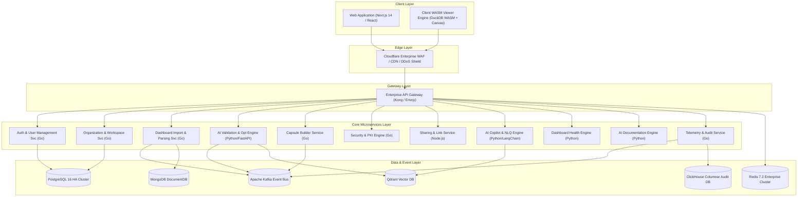

# Master Architecture Blueprint: Dashboard Capsule AI (Phase 1 Final)

## Executive Summary & System Vision

**Dashboard Capsule AI** is an enterprise-grade, AI-native platform designed to revolutionize business intelligence dashboard lifecycle management. Currently, enterprise organizations rely on Power BI, Tableau, and similar tools, suffering from severe pain points: dependency on heavy desktop runtimes, exposed intellectual property in editable files (PBIX), bloat from development artifacts, security risks in external sharing, manual documentation overhead, and lack of automated performance tuning.

Dashboard Capsule AI introduces the proprietary **Secure Interactive Dashboard Capsule (`.dcaps`)** file format and execution runtime. Power BI reports are ingested, parsed into abstract visual and data ASTs (Abstract Syntax Trees), sanitized of development bloat, validated, AI-optimized for performance/accessibility, cryptographically signed, encrypted, and packaged into lightweight `.dcaps` containers. These containers execute client-side via a high-performance **WebAssembly (WASM) / WebGL Rendering Engine**, eliminating Power BI Desktop requirements while guaranteeing zero structural modifications and zero-trust security.

---

## 1. System Requirements & Core Architecture

### High-Level Architecture (C4 Container Diagram)

### Polyglot Persistence Matrix

1. **PostgreSQL 16**: Relational core (Organizations, Workspaces, Users, Subscriptions, Version History, Audit Log indices).
2. **MongoDB 7.0**: Document store for raw and optimized Power BI Layout ASTs, visual properties, custom theme definitions.
3. **Qdrant Vector DB**: Vector embeddings of DAX functions, semantic metadata, table schemas for AI Copilot RAG queries.
4. **ClickHouse**: Columnar storage for petabyte-scale telemetry, view counts, user interaction tracking, and audit trails.
5. **Redis Enterprise Cluster**: In-memory caching, rate-limiting, session states, and WebSocket pub/sub.
6. **AWS S3 / Azure Blob Storage**: Object storage for `.dcaps` compiled capsule binary packages and compressed assets.
