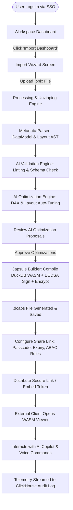

# Deliverable 1 & 2: User Personas & User Journeys

## 1. User Personas Specification

### Persona 1: Senior Dashboard Developer (Alex Rivera)
* **Role**: Lead Power BI Developer & Data Engineer
* **Organization Context**: Enterprise Financial Services firm (5,000+ employees)
* **Goals**:
  * Protect proprietary business logic and DAX formulas from accidental tampering or theft when sharing reports externally.
  * Automate dashboard performance optimization and DAX query tuning without manual refactoring.
  * Package dashboards into clean, lightweight containers stripped of dev artifacts.
* **Pain Points**:
  * End users constantly mess up visual layouts or corrupt measures when given PBIX access.
  * External clients lack Power BI Pro/Premium licenses and cannot view report PBIX files without desktop software.
  * Manual documentation of DAX measures and data model schemas takes up 20%+ of weekly capacity.
* **Key Platform Features Used**: Dashboard Import Engine, AI DAX Optimizer, Capsule Builder (.dcaps), AI Documentation Generator, Version Control.

### Persona 2: Senior Business Analyst (Priya Sharma)
* **Role**: Business Operations Analyst
* **Organization Context**: Global Supply Chain & Logistics SaaS
* **Goals**:
  * Obtain instant insights and answers to complex cross-departmental queries using natural language.
  * Share interactive reports securely with vendor partners without exposing underlying raw database connection strings.
  * View dashboard health metrics to ensure data freshness and visual clarity.
* **Pain Points**:
  * Spent hours explaining complex chart metrics to non-technical operational managers.
  * Struggled to slice and dice heavy 500MB Power BI files on lightweight laptop hardware.
* **Key Platform Features Used**: WASM Interactive Viewer, AI Copilot (NLQ & Voice Commands), AI Health Score, Watermarked Sharing.

### Persona 3: Regional Sales Manager (Marcus Vance)
* **Role**: VP of North America Regional Sales
* **Organization Context**: B2B Enterprise Software Corporation
* **Goals**:
  * Rapidly digest quarterly sales performance metrics on tablet or mobile during travel.
  * Ask conversational questions (e.g., "What was our highest margin product line in Q2 for Enterprise accounts?") without waiting for analyst turnaround.
  * Export secure, encrypted snapshot summaries for executive board meetings.
* **Pain Points**:
  * Frustrated by slow load times and VPN requirements when accessing corporate Power BI servers on mobile.
  * Terrified of sharing sensitive revenue projections via unencrypted email attachments.
* **Key Platform Features Used**: Responsive Mobile Viewer, AI Voice Assistant, Natural Language Query, Secure Passcode Link Sharing.

### Persona 4: Chief Executive Officer (Elena Rostova)
* **Role**: Chief Executive Officer
* **Organization Context**: Fast-growing Fintech Enterprise
* **Goals**:
  * High-level strategic overview of organizational KPIs with AI-generated executive summaries.
  * Zero-friction access: open dashboard links instantly in browser with biometrics/SSO.
  * Full confidence that company financial data cannot be leaked or extracted by competitors.
* **Pain Points**:
  * Overwhelmed by cluttered dashboards containing 40+ charts with no clear priority or metric hierarchy.
  * Demands 100% compliance with zero-trust data governance.
* **Key Platform Features Used**: Executive AI Summary Mode, AI Explain Mode, Zero-Trust Encryption, High-Level Health Index.

### Persona 5: HR Operations Director (Sarah Jenkins)
* **Role**: Director of Global People Operations & HR
* **Organization Context**: Healthcare Enterprise (12,000 Staff)
* **Goals**:
  * Distribute strict HIPAA/GDPR compliant workforce analytics dashboards to department heads.
  * Enforce strict Attribute-Based Access Control (ABAC) so managers only see their direct reporting tree data.
  * Track exact audit logs of who viewed sensitive compensation metrics.
* **Pain Points**:
  * Accidental over-exposure of confidential employee salary data when sharing static PDF or PBIX reports.
  * Inability to audit external access to sensitive HR reports.
* **Key Platform Features Used**: ABAC Security Engine, Dynamic Data Watermarking, Immutable ClickHouse Audit Logs, Role-Based Expiration Links.

### Persona 6: External Client Partner (David Chen)
* **Role**: Managing Director at External Advisory Firm
* **Organization Context**: Independent Consulting Partner
* **Goals**:
  * Review client deliverable dashboards in an ultra-sleek, responsive interactive portal without installing software.
  * Interactively filter data, drill down into drill-through paths, and export high-res sanitized visuals.
* **Pain Points**:
  * Prompted to create complex Microsoft Azure AD guest accounts just to view a single Power BI report.
  * Frustrated by broken visual slicers and static non-interactive PDF client deliverables.
* **Key Platform Features Used**: Zero-Install WASM Web Viewer, Domain-Restricted Secure Links, Passcode Protection, AI Explain Mode.

### Persona 7: Chief Information Security Officer / Admin (Robert Taylor)
* **Role**: VP of Enterprise Security & Infrastructure Admin
* **Organization Context**: Fortune 500 Enterprise
* **Goals**:
  * Maintain centralized IAM control via SAML 2.0 / OIDC and SCIM 2.0 automated provisioning.
  * Enforce zero-trust envelope encryption (AES-256-GCM) for all static and transient BI artifacts.
  * Comprehensive SIEM integration via real-time telemetry streaming into Splunk/Datadog.
* **Pain Points**:
  * Shadow IT: employees emailing unencrypted PBIX files containing sensitive customer PII.
  * Inability to revoke access to exported BI files after an employee leaves the company.
* **Key Platform Features Used**: Enterprise SSO/SCIM Admin Panel, Key Management Service (KMS), Remote Capsule Revocation, Audit Log Streams.

---

## 2. End-to-End User Journey Maps

### Complete Step-by-Step Step Journeys

#### Journey A: Developer Ingestion to Secured `.dcaps` Publishing
1. **Authentication**: Developer logs into `app.capsule.ai` via Okta SAML SSO.
2. **Workspace Navigation**: Selects "Global Supply Chain Workspace" and clicks `+ New Capsule`.
3. **Upload**: Drag-and-drops `Q3_Logistics_Final.pbix` (240MB).
4. **Parsing**: Progress modal displays real-time stages: *Unpacking ZIP Container* $\rightarrow$ *Extracting DataModel* $\rightarrow$ *Parsing DAX AST*.
5. **AI Validation & Linting**: AI Engine identifies 4 unused columns (saving 42MB), 1 circular relationship, and 2 DAX measures missing `DIVIDE()` error handling.
6. **AI Optimization**: Developer clicks `Apply AI Refactoring`. DAX queries are rewritten into optimized storage engine syntax.
7. **Packaging**: Capsule Builder compiles the data model into DuckDB WASM columnar format, injects visual layout JSON, signs with platform ECDSA P-384 key, and encrypts payload with AES-256-GCM.
8. **Publish & Share**: Developer sets share rules (Expires in 14 days, Passcode required, Watermark: "CONFIDENTIAL - LOGISTICS CORP").
9. **Verification**: Generates a share URL `https://capsule.ai/s/v98f21a09b`.

#### Journey B: Executive Viewing & Conversational AI Exploration
1. **Access**: CEO receives passcode-protected link via Slack/Email.
2. **Handshake**: Clicks link, enters 6-digit passcode. Client performs TLS 1.3 key exchange and receives ephemeral decryption key.
3. **WASM Hydration**: In under 400ms, the browser loads the lightweight HTML shell, decrypts `.dcaps` payload in WebAssembly memory, and renders 60 FPS Canvas visuals.
4. **AI Summary**: CEO clicks `Executive AI Summary` tab; AI Copilot generates a 3-bullet executive briefing of key outliers.
5. **Voice Query**: CEO taps microphone icon and speaks: *"Show me regional transport delays exceeding 48 hours in the Midwest."*
6. **Client-side Filter Execution**: AI Copilot parses intent, generates SQL for DuckDB WASM, and filters visual charts instantly (<30ms).
