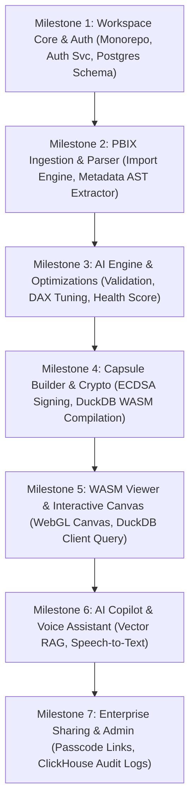

# Deliverable 11-15: Monorepo, Standards, Build Roadmap, Risks & Acceptance Criteria

## 1. Verified Monorepo Workspace Structure

```
dashboard-capsule-ai/
├── .github/                       # CI/CD Workflows, GitHub Actions, CodeQL
│   ├── workflows/
│   │   ├── ci-main.yml
│   │   ├── deploy-staging.yml
│   │   └── security-scan.yml
├── apps/                          # Frontends & Client Runtimes
│   ├── landing-web/               # Public Site & Marketing (Next.js 14)
│   ├── app-dashboard/             # Main SaaS Workspace Shell (Next.js 14)
│   ├── admin-portal/              # Enterprise Admin Panel (Next.js 14)
│   └── viewer-runtime-wasm/       # Rust/C++ DuckDB WASM Engine + WebGL Canvas
├── services/                      # Microservice Backend Implementations
│   ├── api-gateway/               # Kong / Envoy Gateways & Plugins
│   ├── auth-service/              # Go OAuth2, SAML 2.0, JWT Service
│   ├── import-engine/             # Go PBIX Stream & ZIP Extractor
│   ├── metadata-parser/           # Python AST Parser (DataModel & Layout)
│   ├── ai-core/                   # Python FastAPI AI Validation, Opt & Copilot
│   ├── capsule-builder/           # Go `.dcaps` Compiler & Encryptor
│   ├── security-engine/           # Go ECDSA Signer & KMS Key Manager
│   ├── sharing-service/           # Node.js Passcode & Share Link Handler
│   └── analytics-service/         # Go Telemetry Ingestor for ClickHouse
├── packages/                      # Shared Code Libraries
│   ├── ui-kit/                    # Design System Tokens & React Components
│   ├── dcaps-spec/                # Protobuf Definitions for AST & Files
│   ├── crypto-sdk/                # Client & Server AES-GCM Crypto Helpers
│   ├── database/                  # PostgreSQL Migrations & Prisma/SQLc Schemas
│   └── ts-types/                  # Shared TypeScript Interfaces
├── infra/                         # Infrastructure & Cloud Provisioning
│   ├── terraform/                 # Multi-cloud Modules (AWS / GCP / Azure)
│   ├── kubernetes/                # Helm Charts & Kustomize Overlays
│   └── argocd/                    # GitOps Continuous Deployment Specs
├── database/                      # Migration Scripts & Seed Data
│   ├── postgres/
│   ├── mongo/
│   └── clickhouse/
├── docs/                          # Master Architecture & Technical Design Specs
└── scripts/                       # Local Dev Orchestration & Seed Scripts
```

---

## 2. Engineering & Development Standards

### 2.1 Git Branching Strategy (Trunk-Based Development)
* `main`: Production-ready branch. Protected. Direct pushes strictly prohibited.
* `staging`: Pre-production validation branch for integration testing.
* `feature/<issue-id>-short-description`: Short-lived feature branches (<48h).
* `fix/<issue-id>-short-description`: Hotfix branches.

### 2.2 Conventional Commit Standard
Format: `<type>(<scope>): <short descriptive summary>`
- Types: `feat`, `fix`, `docs`, `style`, `refactor`, `perf`, `test`, `chore`, `ci`, `sec`.
- Example: `feat(capsule-builder): implement ECDSA P-384 digital signature packing`

### 2.3 Code Quality & Testing Strategy
* **Unit Testing Target**: Minimum **85% code coverage** for core services (`Go`, `Python`, `TypeScript`).
* **Integration Testing**: Automated Playwright end-to-end browser tests verifying `.dcaps` file upload through WASM client rendering.
* **Security Scanning**: Static Application Security Testing (SAST) via CodeQL & Semgrep on every Pull Request; container scanning via Trivy.

---

## 3. Strict Development Order & Dependencies (Milestones)



---

## 4. Comprehensive Risk Matrix & Mitigation Strategies

| Risk ID | Risk Category | Risk Scenario Description | Risk Level | Enterprise Mitigation Strategy |
| :--- | :--- | :--- | :---: | :--- |
| **R-01** | Security | Client WASM memory inspection attempt to extract raw decrypted columns. | HIGH | Obfuscate WASM binary output, encrypt memory buffers, trigger auto-wipe on window blur or devtools open. |
| **R-02** | Technical | Browser Out-of-Memory crash when loading multi-gigabyte `.dcaps` datasets. | HIGH | Enforce strict server-side aggregation during `.dcaps` compilation; cap raw client DuckDB tables at 500k rows. |
| **R-03** | AI Quality | AI Copilot hallucinates non-existent DAX measures or incorrect filters. | MEDIUM | Constrain LLM SQL generation strictly within dataset AST schema boundaries; run deterministic schema validator. |
| **R-04** | Operational | Third-party Power BI file format changes in Microsoft updates breaking parser. | MEDIUM | Maintain decoupled VertiPaq parsing adapters; write regression suite testing against weekly PBIX sample files. |
| **R-05** | Deployment | Multi-region database sync latency causing stale permission checks on share links. | LOW | Utilize Redis Enterprise global active-active cluster for instantaneous share token permission validation. |

---

## 5. Measurable Acceptance Criteria Specification

### 5.1 Ingestion & Capsule Generation Acceptance Criteria
1. **PBIX Unpacking**: Must unpack `.pbix` files up to 500MB within 10 seconds without memory leaks.
2. **AST Parsing Accuracy**: 100% extraction of visual layout properties, DAX measures, M queries, and table relationships.
3. **Capsule Compression**: Compiled `.dcaps` archive must achieve a minimum **40% size reduction** compared to original `.pbix` file.
4. **Digital Signature**: Verification of ECDSA P-384 signature must succeed on valid capsules and fail instantly ($\le 5\text{ms}$) on modified binary bytes.

### 5.2 WASM Viewer Performance Acceptance Criteria
1. **Initial Load Time**: Cold start load of `.dcaps` container inside browser must complete in **$< 500\text{ms}$ (P95)** on standard 4G networks.
2. **Filter Latency**: Slicer and visual filter executions processed via client DuckDB WASM must respond in **$< 50\text{ms}$**.
3. **Zero Power BI Dependency**: Viewer must execute cleanly in isolated browser environments with zero calls to `powerbi.com` or Microsoft APIs.

### 5.3 AI Copilot & Voice Acceptance Criteria
1. **NLQ Accuracy**: Natural language queries must correctly map to valid dataset fields and SQL filters with $>95\%$ accuracy on benchmark queries.
2. **Voice Response**: Voice commands via Whisper WASM must transcribe audio and update dashboard filters within $<1.5$ seconds of speech completion.
