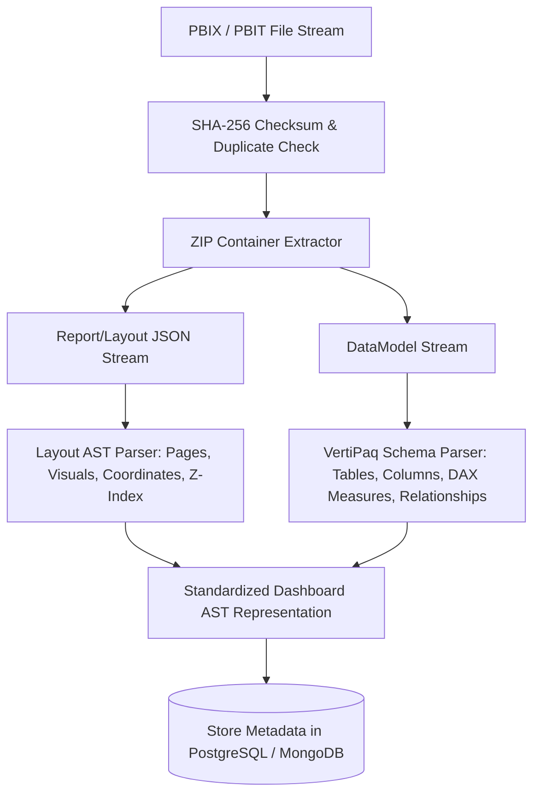

# Deliverable 08: PBIX Import Engine & Dashboard Parser Specification

## 1. PBIX Archive Layout & Binary Unzipping Topology

Power BI `.pbix` and `.pbit` files are ZIP-compressed binary archives containing structured report streams:

```
[ PBIX / PBIT Archive ]
├── Report/
│   ├── Layout                  # JSON file defining Pages, Visual Containers, Coordinates, Formatting
│   └── StaticResources/        # Embedded Images, Icons, Custom Visual CSS/JS
├── DataModel                   # Binary VertiPaq Columnar Data Engine Schema & Data Streams
├── [Content_Types].xml         # Package Content Type Manifest
├── SecuritySelections          # Row-Level Security (RLS) Filter Definitions
├── Metadata                    # Report Metadata & Versioning Flags
└── LinguisticSchema            # Natural Language Q&A Synonym & Synonym Index
```

---

## 2. Ingestion & AST Parsing Pipeline



---

## 3. Standardized Dashboard AST JSON Schema

The extracted layout and data model are normalized into a unified AST JSON representation:

```json
{
  "id": "dash_3c91a02b-1111-482a-b001-eef1108229ab",
  "name": "Q3_Logistics_Global.pbix",
  "pbixFingerprintSha256": "8f9102ab30c92019a82019...",
  "pages": [
    {
      "id": "sec_q3_overview",
      "displayName": "Q3 Overview",
      "ordinal": 1,
      "width": 1280,
      "height": 720,
      "visuals": [
        {
          "id": "vis_101",
          "type": "barChart",
          "x": 40,
          "y": 40,
          "width": 400,
          "height": 250,
          "zIndex": 1,
          "fields": ["Fact_Shipments.CarrierCode", "Fact_Shipments.FreightCost"]
        }
      ]
    }
  ],
  "tables": [
    {
      "name": "Fact_Shipments",
      "columns": [
        { "name": "ShipmentID", "dataType": "String", "isCalculated": false },
        { "name": "FreightCost", "dataType": "Decimal", "isCalculated": false }
      ]
    }
  ],
  "measures": [
    {
      "name": "Total Freight Cost",
      "tableName": "Fact_Shipments",
      "expression": "SUM(Fact_Shipments[FreightCost])"
    }
  ]
}
```
