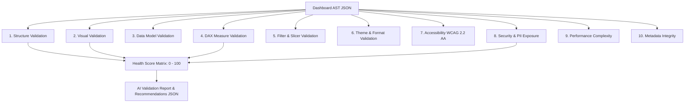

# Deliverable 09: AI Validation Engine Architecture & Rule Specifications

## 1. Executive Summary & Validation Pipeline

The **AI Validation Engine** inspects the raw Abstract Syntax Tree (AST) generated by the Ingestion Engine during Phase 5. It detects structural, visual, data model, DAX measure, filter, accessibility, security, and performance anti-patterns before `.dcaps` compilation.

---

## 2. Validation Module Specifications

| Module ID | Category | Primary Purpose & Detection Rules |
| :--- | :--- | :--- |
| **VAL-01** | Structure | Detects empty pages, missing sections, circular page navigation links, and unreferenced hidden pages. |
| **VAL-02** | Visual | Detects off-canvas visual containers ($x < 0$ or $x > 1280$), overlapping chart coordinates, and empty visuals. |
| **VAL-03** | Data Model | Identifies orphan tables, circular foreign key relationships, unindexed primary keys, and duplicate column names. |
| **VAL-04** | DAX Measures | Identifies `FILTER(ALL(...))` full table scans, `SUMX` bottlenecks, and missing `DIVIDE()` zero-division handling. |
| **VAL-05** | Filters | Identifies conflicting visual filters, inactive slicers, and invalid cross-filtering directions. |
| **VAL-06** | Theme | Checks color contrast compliance and font family uniformity. |
| **VAL-07** | Accessibility| Verifies WCAG 2.2 AA minimum contrast ($4.5:1$), focus ring visibility, and visual alt text labels. |
| **VAL-08** | Security | Scans table columns for unmasked PII patterns (`ssn`, `salary`, `credit_card`, `password`, `dob`, `pin`). |
| **VAL-09** | Performance | Calculates visual density per page ($>15$ visuals triggers warning) and relationship traversal depth. |
| **VAL-10** | Metadata | Validates SHA-256 fingerprint integrity and Protobuf schema version compatibility. |

---

## 3. Severity Level & Scoring Algorithm

The overall validation score $S \in [0, 100]$ is computed as:
$$S = \max\left(0, 100 - (20 \cdot C + 10 \cdot H + 5 \cdot M + 2 \cdot L)\right)$$

Where:
- $C$: Critical Findings Count (Security violations, empty layout, broken data model)
- $H$: High Severity Findings Count (DAX `FILTER(ALL)` misuse, off-canvas visuals)
- $M$: Medium Severity Findings Count (Empty pages, missing alt text)
- $L$: Low Severity Findings Count (Minor theme contrast warnings)
