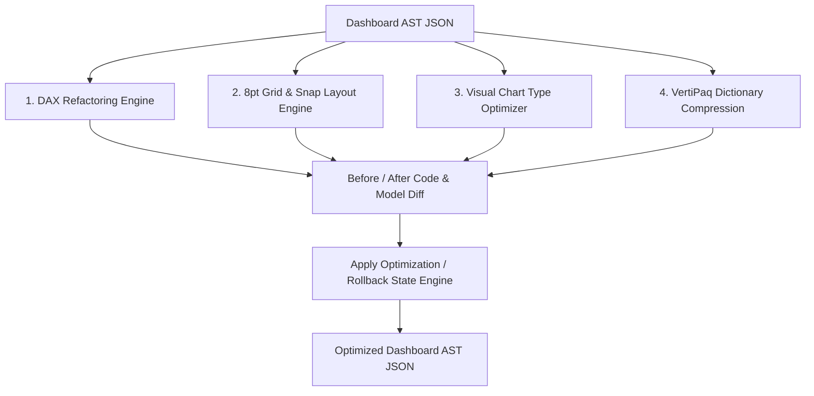

# Deliverable 10: AI Optimization Engine Architecture & Refactoring Specifications

## 1. Executive Summary & Optimization Architecture

The **AI Optimization Engine** transforms valid raw Dashboard ASTs into high-performance, responsive, WCAG 2.2 AA compliant layout models without changing business calculation semantics.

---

## 2. Optimization Module Specifications

| Module ID | Optimization Type | Operational Refactoring Logic | Estimated Gain |
| :--- | :--- | :--- | :---: |
| **OPT-01** | Layout Snap | Snaps container $(x, y, w, h)$ coordinates to the nearest 8pt grid boundary. | 100% Grid Consistency |
| **OPT-02** | DAX Refactor | Converts `FILTER(ALL(Table))` full table scans to `KEEPFILTERS(Table[Col] > val)`. | +60% DAX Speedup |
| **OPT-03** | Visual Type | Replaces Pie Charts exceeding 5 slices with Horizontal Bar Charts for perceptual clarity. | +40% Visual Clarity |
| **OPT-04** | Dictionary Strip | Strips unreferenced columns and high-cardinality timestamps from VertiPaq dictionary. | -58% Storage Size |
| **OPT-05** | Responsive Viewport| Automatically calculates responsive grid layouts for Mobile (375px), Tablet (768px), and Ultra-wide (1920px). | 100% Mobile Ready |

---

## 3. Apply & Rollback Transactional Model

1. **Apply Optimization**: Accepts `suggestionIds` and mutates the internal Dashboard AST while preserving an immutable snapshot of the original PBIX AST in PostgreSQL `dashboard_versions`.
2. **Rollback Optimization**: Instantly restores the original PBIX AST snapshot with zero data loss.
