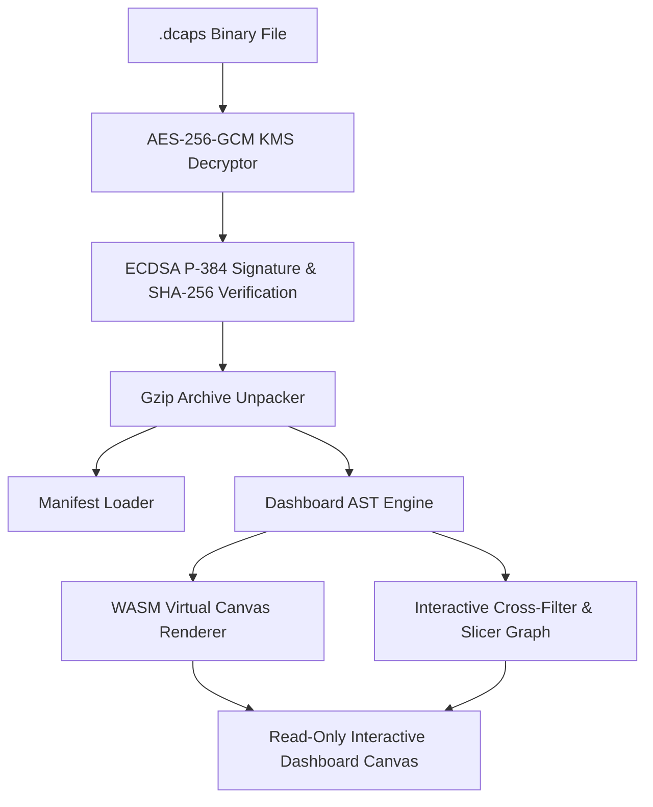

# Deliverable 12: Dashboard Viewer Runtime & Interactive Engine Specification

## 1. Executive Summary & Canvas Architecture

The **Dashboard Viewer Runtime** (`apps/viewer`) is a client-side WebAssembly (WASM) and React execution engine capable of opening `.dcaps` binary containers without requiring Power BI Desktop or Power BI Service subscriptions.

---

## 2. Interactive Feature Matrix

| Feature | Operational Capability | Security Enforcement |
| :--- | :--- | :--- |
| **Cross-Filtering** | Clicking a chart slice filters connected canvas visuals in real-time. | Canvas visual coordinates ($X, Y, W, H$) are immutable. |
| **Page Navigation** | Seamless switching between report section pages. | Visual deletion, movement, or resizing is strictly disabled. |
| **Slicers & Filters** | Multi-select drop-down slicers with reset controls. | DAX measure logic cannot be modified or inspected. |
| **Presentation Mode** | Fullscreen borderless viewing for executive boardrooms. | Password/passcode locks enforced on external links. |

---

## 3. Interaction Analytics Capture

Every viewer session records interaction telemetry to ClickHouse columnar storage for usage metrics:
- **`PAGE_SWITCH`**: Tracks page focus duration.
- **`SLICER_CHANGE`**: Records slice choices.
- **`CROSS_FILTER`**: Captures chart visual interaction heatmaps.
