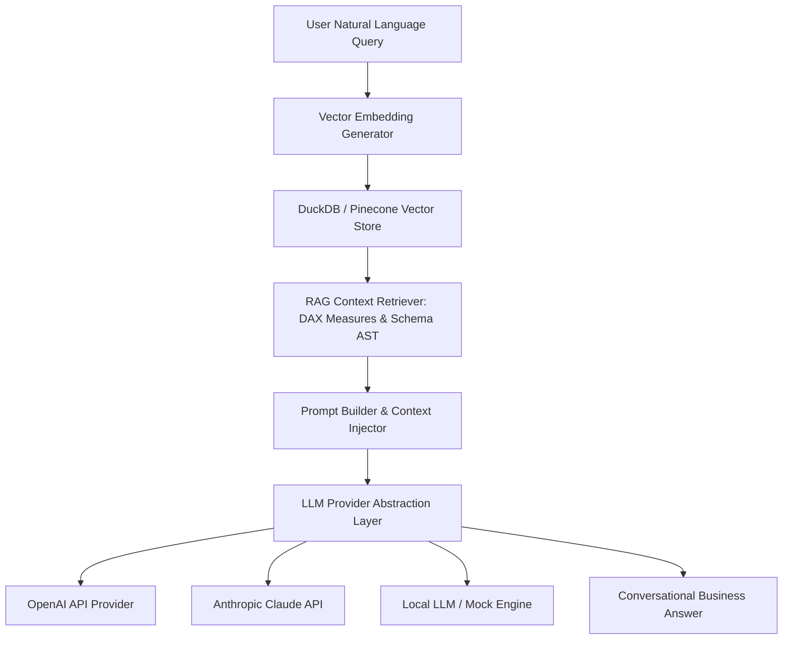

# Deliverable 13: AI Copilot RAG Architecture & Provider Specification

## 1. Executive Summary & RAG Pipeline

The **AI Copilot & Natural Language Engine** operates over vector embeddings derived from active `.dcaps` AST metadata, DAX measures, validation reports, and telemetry interaction history.



---

## 2. LLM Provider Abstraction Layer

```python
class BaseLLMProvider(ABC):
    @abstractmethod
    def generate_response(self, prompt: str, context: Dict[str, Any]) -> str:
        pass
```

Supports seamless runtime switching between `OPENAI`, `ANTHROPIC`, `AZURE_OPENAI`, and `LOCAL_LLM` providers without modifying core application logic.

---

## 3. Security & Prompt Injection Mitigation

- **Context Isolation**: AST schema data is sanitized prior to context injection.
- **RBAC Enforcement**: The RAG retriever filters vector embeddings based on user role permissions (e.g. non-admin users cannot retrieve salary/compensation measures).
