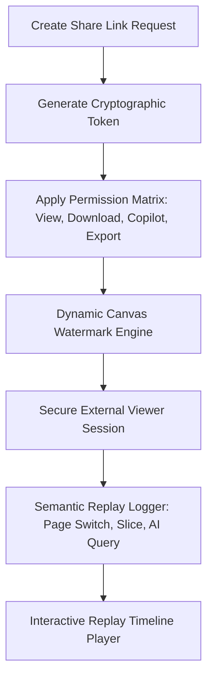

# Deliverable 14: Secure Sharing & Semantic Dashboard Replay Specification

## 1. Executive Summary & Security Architecture

The **Secure Sharing Platform** allows enterprise administrators to generate cryptographically signed share tokens with passcode protection, domain whitelisting, IP restriction, dynamic canvas watermarking, and event-based semantic session replays.



---

## 2. Dynamic Canvas Watermarking Specification

To prevent data leaks and screenshot unauthorized distribution, the canvas viewer renders an semi-transparent SVG watermark overlay:

$$\text{Watermark} = \text{User Name} \parallel \text{Email} \parallel \text{Client IP} \parallel \text{Timestamp (UTC)}$$

- **Opacity**: 7%
- **Rotation**: $-25^\circ$ diagonal tilt across full canvas container.
- **Pointer Events**: `none` (does not interfere with visual chart click/slice interactions).

---

## 3. Semantic Dashboard Replay Event Schema

Rather than heavy video screen recordings, the Replay Engine logs lightweight JSON events:

```json
{
  "sessionId": "sess_9012a8",
  "stepIndex": 2,
  "eventType": "CROSS_FILTER",
  "payload": {
    "visualId": "vis_bar_1",
    "selectedValue": "FedEx Freight"
  },
  "timestamp": "00:04.250"
}
```
