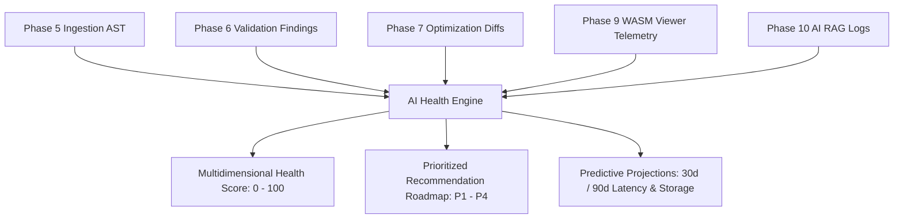

# Deliverable 16: AI Dashboard Health & Intelligence Specification

## 1. Executive Summary & Scoring Architecture

The **Dashboard Health & Intelligence Engine** continuously evaluates imported dashboards by aggregating data from the Ingestion Engine, Validation Engine, Optimization Engine, WASM Viewer Runtime, Telemetry Platform, and AI Copilot into a unified 0–100 Health Score.

---

## 2. Weighted Health Scoring Formula

The Overall Health Score $H \in [0, 100]$ is calculated using a weighted matrix across 7 intelligence dimensions:

$$H = 0.20 S_{\text{Perf}} + 0.20 S_{\text{Sec}} + 0.15 S_{\text{A11y}} + 0.15 S_{\text{Design}} + 0.15 S_{\text{Data}} + 0.10 S_{\text{DAX}} + 0.05 S_{\text{AI}}$$

Where:
- $S_{\text{Perf}}$: WASM query latency & rendering efficiency.
- $S_{\text{Sec}}$: AES-256 KMS encryption, RLS enforcement, PII protection.
- $S_{\text{A11y}}$: WCAG 2.2 AA contrast ratios & screen reader alt text.
- $S_{\text{Design}}$: 8pt grid snap alignment & visual container bounds.
- $S_{\text{Data}}$: VertiPaq schema cardinality & unreferenced column counts.
- $S_{\text{DAX}}$: Sub-50ms DAX measure evaluation & `DIVIDE()` safety.
- $S_{\text{AI}}$: RAG vector coverage & recommendation acceptance.

---

## 3. Predictive Projections

The engine uses historical telemetry time-series regression to project metric growth:
- **Query Latency Projections**: Predicts WASM evaluation slowing as row count scales.
- **Storage Footprint Projections**: Models archive size expansion over 30 and 90 days.
- **User Adoption Projections**: Predicts monthly active viewer growth.
