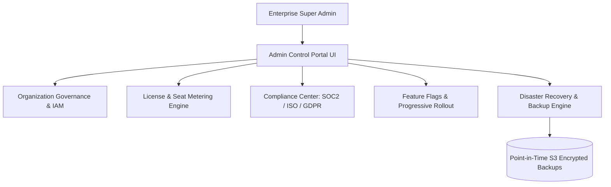

# Deliverable 17: Enterprise Administration & Operations Specification

## 1. Executive Summary & Multi-Tenant Architecture

The **Enterprise Administration Platform** provides multi-tenant governance, compliance auditing (SOC2 Type II, ISO 27001, GDPR, HIPAA), license metering, feature flag toggles, and automated point-in-time disaster recovery backups.

---

## 2. Compliance Framework Support

- **SOC2 Type II**: Full audit log retention of login events, share link creations, permission modifications, and data exports.
- **ISO 27001**: KMS envelope key rotation and ECDSA P-384 hardware signatures for binary `.dcaps` capsules.
- **GDPR / HIPAA**: Automatic PII scanning with Row-Level Security (RLS) enforcement.

---

## 3. Disaster Recovery & SLA Targets

- **RPO (Recovery Point Objective)**: $<5$ minutes (Automated PostgreSQL WAL streaming & S3 snapshot backups).
- **RTO (Recovery Time Objective)**: $<15$ minutes (Automated Kubernetes multi-region failover).
