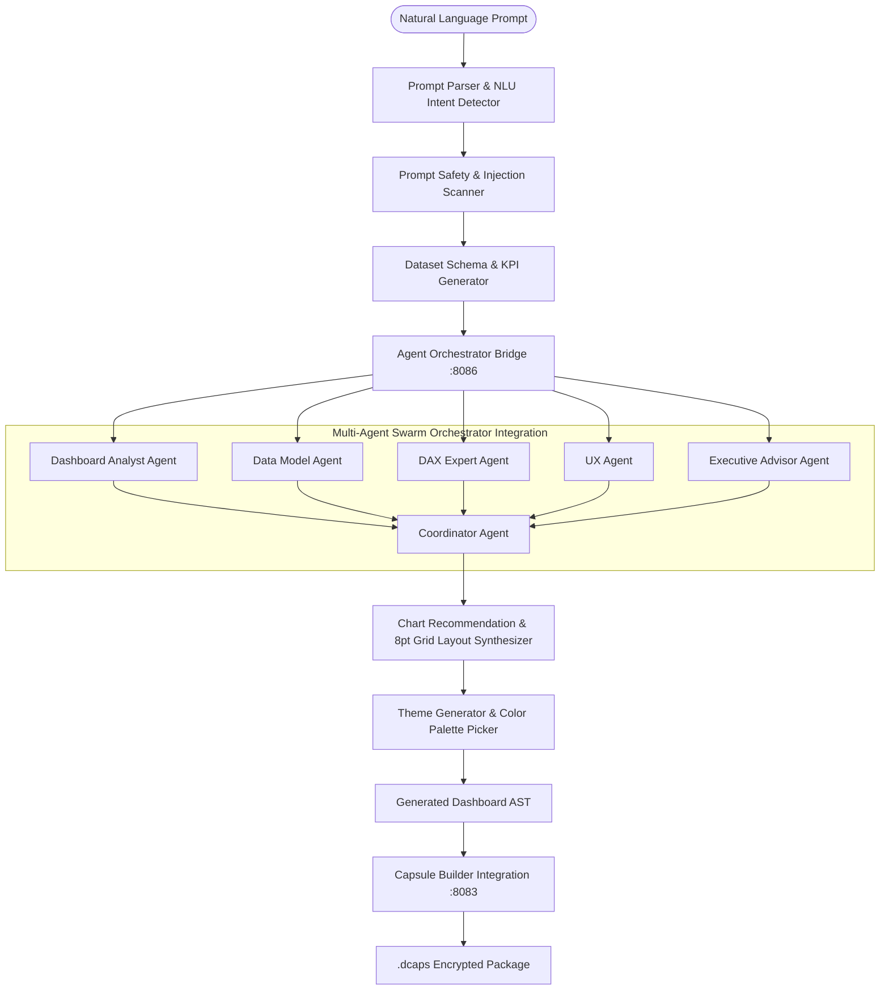

# Version 2.0 Phase 19 AI Dashboard Builder Architecture Specification

---

## 1. Executive Architecture Overview

Dashboard Capsule AI Version 2.0 Phase 19 introduces the **Enterprise AI Dashboard Builder Platform** (`services/dashboard-builder`). This service enables users to synthesize full, interactive executive business dashboards from natural language prompts (e.g. *"Create a sales dashboard for the last 12 months"* or *"Build an HR dashboard showing attrition, hiring and department performance"*).

---

## 2. Supported Business Domains

- **Sales Analytics**: Revenue, sales quota, rep performance, pipeline velocity.
- **Corporate Finance**: Net profit margin %, EBITDA, operating expense variance.
- **Marketing Campaigns**: Campaign ROI, click-through rates, customer acquisition cost.
- **Human Resources (HR)**: Voluntary/involuntary attrition %, active headcount, recruitment funnel.
- **Operations & Logistics**: Carrier SLA compliance, transit delay hours, port congestion.
- **Supply Chain**: Inventory turnover, lead time variance, order fulfillment.
- **Healthcare**: Patient readmission rates, bed occupancy, treatment costs.
- **Manufacturing**: Plant OEE, defect rates, machine downtime.
- **Retail & E-commerce**: Store SKU velocity, cart abandonment, average order value.

---

## 3. REST API v2 Specifications

- `POST /api/v2/dashboard-builder/generate` — Generate complete dashboard AST from natural language prompt.
- `POST /api/v2/dashboard-builder/preview` — Fast preview of visual containers, DAX measures, and recommended charts.
- `POST /api/v2/dashboard-builder/build` — Compile generated AST into `.dcaps` binary package.
- `GET /api/v2/dashboard-builder/templates` — List built-in industry dashboard templates.
- `GET /api/v2/dashboard-builder/history` — Query prompt history logs.
