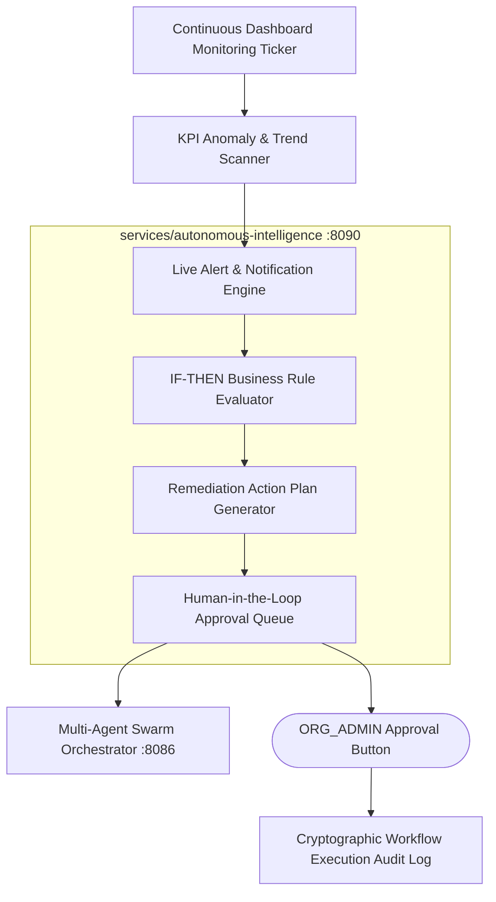

# Version 2.0 Phase 21 Autonomous Enterprise Intelligence Architecture

---

## 1. Executive Architecture Overview

Dashboard Capsule AI Version 2.0 Phase 21 introduces the **Autonomous Enterprise Intelligence Platform** (`services/autonomous-intelligence`). This service establishes a continuous background monitoring engine that detects KPI deviations, flags abnormal trend variances, evaluates IF-THEN business rules, queue human-in-the-loop action plans, and logs cryptographic execution audits.

---

## 2. Autonomous Capabilities

1. **Continuous Dashboard Monitoring Engine**: Periodically scans active visual AST measures to detect KPI deviations against moving averages, SLA delays, data staleness, and unmasked PII.
2. **IF-THEN Workflow Automation Engine**: Executes declarative rules such as:
   - *IF Freight Revenue Margin drops by > 10%* $\rightarrow$ *THEN Run Multi-Agent AI Analysis $\rightarrow$ Generate Action Plan $\rightarrow$ Require ORG_ADMIN Signoff $\rightarrow$ Log Audit*.
3. **Human-in-the-Loop Approval Queue**: Enforces enterprise governance by requiring explicit administrative signoff for high-impact remediation actions.

---

## 3. REST API v2 Specifications

- `POST /api/v2/intelligence/rules` — Configure monitoring threshold & alert rules.
- `POST /api/v2/intelligence/analyze` — Trigger on-demand autonomous intelligence audit.
- `POST /api/v2/intelligence/workflows` — Register IF-THEN automated workflow definitions.
- `POST /api/v2/intelligence/approve` — Approve or reject pending workflow action plans.
- `GET /api/v2/intelligence/alerts` — Fetch active anomaly alerts and priority levels.
- `GET /api/v2/intelligence/recommendations` — Fetch AI remediation action recommendations.
- `GET /api/v2/intelligence/action-plans` — List prioritized action plans.
- `GET /api/v2/intelligence/history` — Query workflow execution audit logs.
