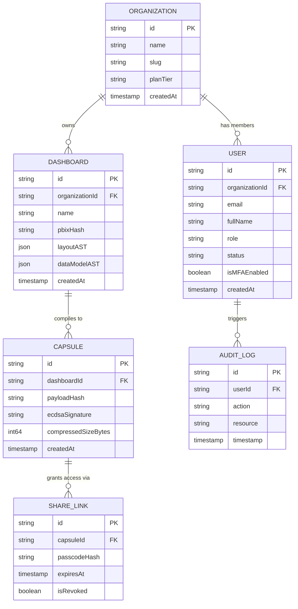

# Database Schema Dictionary & Entity Relationship Blueprint

Dashboard Capsule AI Version 1.0.0 uses PostgreSQL 16 for core transactional data and multi-tenant organization state.

---

## 1. Entity Relationship (ER) Diagram

---

## 2. Table Data Dictionary

### Table: `organizations`
| Column Name | Data Type | Nullable | Constraints / Indexes | Description |
| :--- | :--- | :---: | :--- | :--- |
| `id` | `VARCHAR(64)` | NO | PRIMARY KEY | Unique Organization ID (`org_*`) |
| `name` | `VARCHAR(255)` | NO | — | Display Name of Enterprise Org |
| `slug` | `VARCHAR(128)` | NO | UNIQUE INDEX | URL-safe Organization Slug |
| `plan_tier` | `VARCHAR(32)` | NO | DEFAULT `'ENTERPRISE'` | Billing Tier (`FREE`, `PRO`, `ENTERPRISE`) |
| `created_at` | `TIMESTAMPTZ` | NO | DEFAULT `NOW()` | Timestamp of Organization Creation |

### Table: `users`
| Column Name | Data Type | Nullable | Constraints / Indexes | Description |
| :--- | :--- | :---: | :--- | :--- |
| `id` | `VARCHAR(64)` | NO | PRIMARY KEY | Unique User ID (`usr_*`) |
| `organization_id` | `VARCHAR(64)` | NO | FOREIGN KEY (`organizations.id`) | Tenant Parent ID |
| `email` | `VARCHAR(255)` | NO | UNIQUE INDEX | User Work Email |
| `password_hash` | `VARCHAR(255)` | NO | — | Bcrypt Hash of Password |
| `full_name` | `VARCHAR(255)` | NO | — | User Display Name |
| `role` | `VARCHAR(64)` | NO | INDEX | RBAC Role (`ORG_ADMIN`, `DEVELOPER`, etc.) |
| `status` | `VARCHAR(32)` | NO | DEFAULT `'ACTIVE'` | Account Status (`ACTIVE`, `SUSPENDED`) |
| `created_at` | `TIMESTAMPTZ` | NO | DEFAULT `NOW()` | Registration Timestamp |

### Table: `capsules`
| Column Name | Data Type | Nullable | Constraints / Indexes | Description |
| :--- | :--- | :---: | :--- | :--- |
| `id` | `VARCHAR(64)` | NO | PRIMARY KEY | Unique Capsule ID (`caps_*`) |
| `dashboard_id` | `VARCHAR(64)` | NO | INDEX | Associated Source Dashboard ID |
| `payload_hash` | `VARCHAR(64)` | NO | — | SHA-256 Hash of Encrypted Binary Payload |
| `signature` | `TEXT` | NO | — | ECDSA P-384 Digital Signature |
| `created_at` | `TIMESTAMPTZ` | NO | DEFAULT `NOW()` | Capsule Compilation Timestamp |
