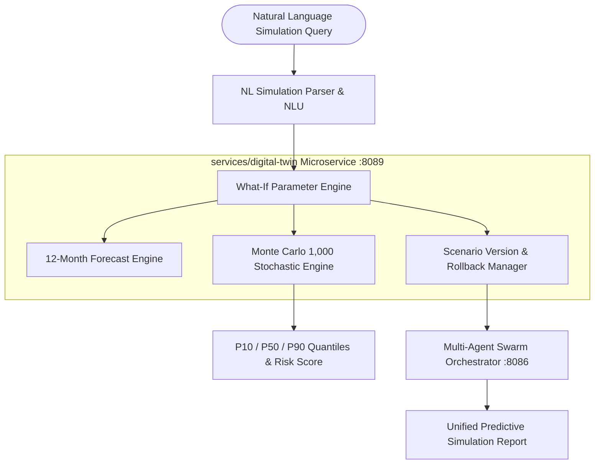

# Version 2.0 Phase 20 Predictive Simulation & Digital Twin Platform Architecture

---

## 1. Executive Architecture Overview

Dashboard Capsule AI Version 2.0 Phase 20 introduces the **Predictive Simulation & Digital Twin Platform** (`services/digital-twin`). This service elevates Dashboard Capsule AI from historical analytics into a forward-looking predictive engine capable of 12-month time-series forecasting, Monte Carlo stochastic risk quantification (1,000 runs), natural language scenario simulation, and versioned scenario rollback.

---

## 2. Mathematical Simulation Engines

1. **12-Month Predictive Forecast Engine**: Extrapolates baseline metric trends using compound exponential growth formulas, calculating 95% upper and lower confidence bounds for each future month.
2. **Monte Carlo Stochastic Engine**: Executes 1,000 random-walk iterations using Box-Muller Gaussian transformations to compute probability distributions, standard deviation, and risk quantiles:
   - **P10 (Conservative Floor)**: 90% probability of exceeding.
   - **P50 (Expected Baseline)**: Median expectation.
   - **P90 (Optimistic Upside)**: 10% probability of exceeding.
3. **Scenario Versioning & Rollback**: Manages immutable state snapshots for Base, Optimistic, and Stress test scenarios, enabling instant version rollback to baseline checkpoints.

---

## 3. REST API v2 Specifications

- `POST /api/v2/digital-twin/create` — Initialize a digital twin model for a dashboard.
- `POST /api/v2/digital-twin/simulate` — Execute what-if parameter modification or Monte Carlo stochastic run.
- `POST /api/v2/digital-twin/forecast` — Generate 12-month predictive metric forecast.
- `POST /api/v2/digital-twin/compare` — Compare Base vs Optimistic vs Severe Stress scenarios.
- `POST /api/v2/digital-twin/rollback` — Revert digital twin state to specific version checkpoint.
- `GET /api/v2/digital-twin/history` — Query simulation run history and logs.
- `GET /api/v2/digital-twin/models` — List active digital twin models.
- `GET /api/v2/digital-twin/recommendations` — Export AI decision recommendations & risk assessments.
