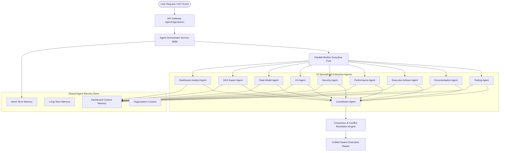

# Version 2.0 Enterprise Multi-Agent AI Platform Specification

---

## 1. Executive Architecture Overview

Dashboard Capsule AI Version 2.0 introduces an Enterprise Multi-Agent AI System (`services/agent-orchestrator`). Rather than relying on a single monolithic LLM prompt, Version 2.0 deploys a swarm of **10 specialized enterprise agents** operating concurrently with a shared multi-tiered agent memory engine, consensus scoring, and automated conflict resolution.



---

## 2. Implemented Enterprise Agents

1. **Dashboard Analyst Agent (`agent_analyst`)**: Analyzes visual AST layout structure, computes KPI definitions, detects trend changes, and flags operational anomalies.
2. **DAX Expert Agent (`agent_dax`)**: Parses DAX measure AST expressions, identifies table-scan `FILTER(ALL())` patterns, and refactors measures to use optimal `KEEPFILTERS` context transitions.
3. **Data Model Agent (`agent_datamodel`)**: Evaluates entity-relationship cardinality, identifies orphan tables, detects redundant columns, and suggests star-schema pruning.
4. **UX Agent (`agent_ux`)**: Audits visual container coordinates, snaps containers to an 8pt grid system, and enforces WCAG 2.2 AA color contrast compliance.
5. **Security Agent (`agent_security`)**: Scans for raw PII (e.g. unmasked SSNs or tax IDs), validates Row-Level Security (RLS) rules, and audits RBAC permission boundaries.
6. **Performance Agent (`agent_performance`)**: Profiles WebAssembly SIMD visual query rendering latency, CPU execution cycles, memory footprints, and package size compression.
7. **Executive Advisor Agent (`agent_executive`)**: Produces 1-minute executive briefs, 5-minute deep dives, strategic recommendations, business risks, and action items.
8. **Documentation Agent (`agent_documentation`)**: Auto-generates technical specs, OpenAPI 3.1 REST schemas, developer guides, and changelogs.
9. **Testing Agent (`agent_testing`)**: Executes regression test suites across all 15 platform pipeline stages to verify zero functional breakage.
10. **Coordinator Agent (`agent_coordinator`)**: Coordinates parallel swarm execution, assigns subagent tasks, merges findings, computes consensus score, and produces the unified report.

---

## 3. Plugin-Based Agent SDK & Dynamic Registration

The orchestrator enforces a plugin architecture. Developers can register custom agents at runtime without modifying orchestrator core logic:

```go
type Agent interface {
    Manifest() AgentManifest
    CanHandle(cap Capability) bool
    Execute(ctx context.Context, input AgentTaskInput, memoryStore MemoryAccessor) (*AgentExecutionResult, error)
}
```

```go
// Dynamic Agent Registration Example
registry := agents.GetGlobalRegistry()
registry.Register(NewCustomSupplyChainAgent())
```

---

## 4. REST API v2 Specifications

- `POST /api/v2/agents/run` — Launch full multi-agent swarm analysis on a dashboard.
- `POST /api/v2/agents/chat` — Multi-agent contextual team consultation chat.
- `POST /api/v2/agents/task` — Submit specific agent subtask execution.
- `GET /api/v2/agents/status` — Retrieve active agent health, registered capabilities, and worker pool status.
- `GET /api/v2/agents/history` — Fetch historical swarm execution timelines and shared memory records.
- `GET /api/v2/agents/metrics` — Export Prometheus metrics, average consensus scores, and memory usage.
